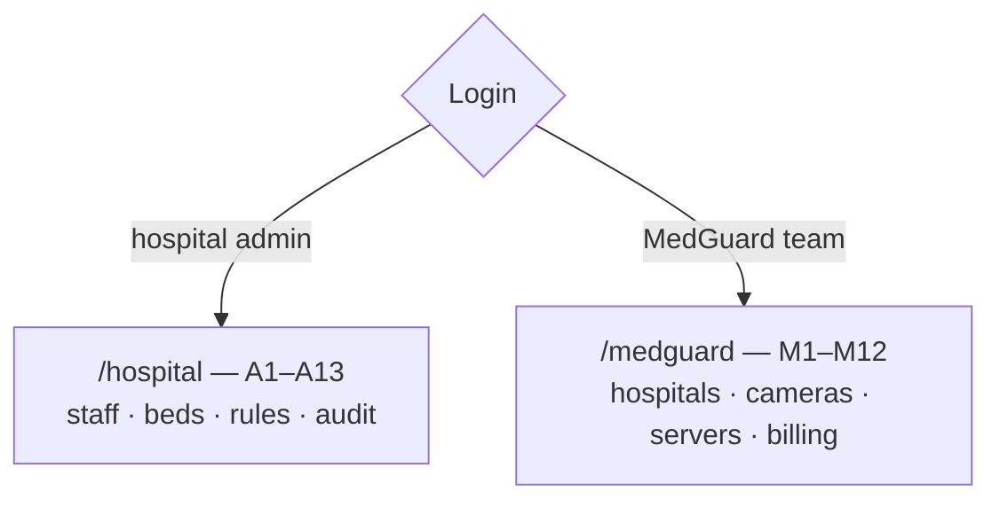

# MedGuard Admin Console — Build Plan

> App 4 of 4 · Desktop web · 25 screens in two areas: Hospital admin (13) + MedGuard team (12)
> Sister apps: `medguard-health-profile` · `medguard-ward` · `medguard-ward-dashboard`

---

## 1. At a glance

| | |
|---|---|
| **What it is** | Setup and control for MedGuard. Hospitals manage their own staff, beds and rules; the MedGuard team handles onboarding, cameras and infrastructure |
| **Who uses it** | **Hospital admin** (self-serve, A1–A13) · **MedGuard team** (internal, M1–M12) |
| **Device** | Desktop browser, 1280 px and up |
| **Security** | Both areas need two-step login. Everything is audited |
| **Languages** | Bangla + English |
| **Theme** | Light only, bluish, identical to the other 3 apps |

**One app, two areas.** Login decides which area you land in; you never see the other side.



**What it controls in the other apps**

| Set here | Shows up in |
|---|---|
| Staff, roles, senior-nurse flag, wards (A4) | Ward app login + permissions, Dashboard staff |
| Beds, bed types, out of service (A6) | Ward app beds, Dashboard bed board + queue |
| Shift pattern, ratio, rest (A7) | Dashboard shift planner warnings |
| Vitals list + normal ranges (A8) | Ward app W39 fields + out-of-range flags |
| Formulary (A9, M9) | Ward app W35 drug search |
| Consent text (A13) | Ward app W30 consent |
| Bed-zone mapping (M6) | Camera boxes + fall alarms per bed |

---

## 2. Build setup (instructions)

- **Stack:** React + Vite + TypeScript + Tailwind CSS v4.
- **Libraries (only these):** `react-router-dom`, `lucide-react`. Charts only if needed on A2/M2 → `recharts`. Plus `gsap` + `@gsap/react` for animation and parallax (see root README).
- **State:** React context. Mock data in `src/mock/`.
- **i18n:** `en.json` + `bn.json` + small `t()` hook.
- **Two route trees:** `/hospital/*` and `/medguard/*`, each with its own sidebar. A `RequireArea` wrapper bounces the wrong user.
- **Bed-zone mapping (M6):** plain `<svg>` over the camera frame image; mouse-drag draws a rectangle; each rect gets a bed dropdown. No canvas library.
- **Export (A11):** CSV via `Blob` download.
- **Session:** auto-lock after 10 min idle.
- **Folder layout:**

```
src/
  app/         routes.tsx, HospitalShell, MedguardShell, RequireArea
  screens/     hospital/ (A1–A13), medguard/ (M1–M12)
  components/  section 4
  mock/  i18n/  dev/
```

---

## 3. Theme (same in all 4 apps)

Tokens in `src/index.css` under Tailwind v4 `@theme`:

```css
--primary-700:#174C99; --primary-600:#1D5FBF; --primary-100:#D6E6FB; --primary-50:#EAF2FD;
--page:#F5F8FC; --surface:#FFFFFF;
--ink-900:#0F1B2D; --ink-700:#475467; --ink-500:#5B6B80;
--border-input:#7B8BA1; --border-subtle:#E3E9F1;
--danger-text:#B42318;  --danger-bg:#FEF3F2;  --danger-border:#FDA29B;
--warning-text:#B54708; --warning-bg:#FFFAEB; --warning-border:#FEC84B;
--check-text:#93370D;   --check-bg:#FEF0C7;
--success-text:#067647; --success-bg:#ECFDF3; --success-border:#75E0A7;
--neutral-text:#344054; --neutral-bg:#F2F4F7;
--font: 'Noto Sans','Noto Sans Bengali',system-ui,sans-serif;
radius: 8 controls · 12 cards · 16 dialogs · full chips
spacing: 4 8 12 16 24 32 48 64 only
shadow-bar: 0 1px 3px rgba(15,27,45,.08) · shadow-float: 0 8px 24px rgba(15,27,45,.12)
```

**Desktop rules:** 12-col grid, 24 px gutters, 32 px padding, max 1440 px · buttons 40 px · tables 48 px rows, sticky header, no zebra, `primary-50` hover, sortable, filters above, pagination below · forms: label above, inline errors that say how to fix · status = colour + icon + word · destructive actions red, always confirm + reason.

---

## 4. Layout and components

```
┌──────────────┬────────────────────────────────────────────────────┐
│ MedGuard     │ Shanti Hospital · Hospital admin · 👤 Farhana ▾     │
│ Admin        ├────────────────────────────────────────────────────┤
│ ▌Overview    │ Staff                              [+ Invite staff] │
│  Staff       │ [Search…] [Role ▾] [Ward ▾] [Status ▾]              │
│  Beds        │ ┌──────────────┬──────────┬────────┬────────┬─────┐ │
│  Shift rules │ │ Name         │ Role     │ Wards  │ Status │     │ │
│  Vitals      │ ├──────────────┼──────────┼────────┼────────┼─────┤ │
│  Formulary   │ │ Rina Akter   │ Nurse    │ Neuro B│ ●Active│ ⋯   │ │
│  Emergency   │ │ Shahana P.   │ Nurse ★Sr│ Neuro B│ ●Active│ ⋯   │ │
│  Audit log   │ └──────────────┴──────────┴────────┴────────┴─────┘ │
│  Subscription│                               ‹ 1 2 3 ›             │
│  Settings    │                                                    │
└──────────────┴────────────────────────────────────────────────────┘
```

MedGuard team sidebar: Hospitals · Onboard · Wards & rooms · Cameras · Bed-zone mapping · Servers · Billing · Formulary · BMDC log · Support · Team audit.

| Component | Notes |
|---|---|
| `Sidebar`, `TopBar` (org name, area label, user) |
| `DataTable` | Search, filters, sort, pagination, row actions menu |
| `FormPage` | Sectioned form, sticky Save bar at bottom |
| `ReasonDialog` | Confirm + required reason (deactivate, out of service, escalate) |
| `StatusChip` | Active / Invited / Deactivated · Online / Offline · Reviewed / Escalated / Pending |
| `StatTile`, `EmptyState`, `ErrorState`, `Skeleton` |

---

## 5. Hospital admin screens (13) — `/hospital/*`

| ID | Route | Screen | What's on it |
|---|---|---|---|
| A1 | `/login` | Login | Phone or email → OTP (mock `123456`) → second factor (authenticator code, mock `000000`) |
| A2 | `/hospital` | Hospital overview | Tiles: wards, beds, active staff, cameras online · plan + renewal date · pending emergency-access reviews |
| A3 | `/hospital/staff` | Staff | Table; search by name, role, ward, status |
| A4 | `/hospital/staff/new` · `/:id` | Invite or edit staff | Name, phone, role (nurse / doctor / ward manager / admission desk), doctor tier (consultant / MO / intern), **senior-nurse flag**, wards (multi). Invite sends SMS (mock) |
| A5 | dialog | Deactivate staff | "Access removed immediately. Audit history kept." Reason required |
| A6 | `/hospital/beds` | Beds | Per-ward list; add bed, bed type (general / ICU / observation / private), mark out of service (reason) |
| A7 | `/hospital/shift-rules` | Shift rules | Shift pattern + times (e.g. Morning 8–2, Evening 2–8, Night 8–8), nurse:patient ratio per ward, minimum rest hours |
| A8 | `/hospital/vitals` | Vitals setup | Per ward: which vitals are recorded (checkboxes) + normal range min/max with unit |
| A9 | `/hospital/formulary` | Formulary additions | Hospital's own drugs added to MedGuard base list: brand, generic, strength, form |
| A10 | `/hospital/emergency-access` | Emergency access review | Every emergency access: staff, patient, reason, time · **Mark reviewed** / **Escalate** (reason) |
| A11 | `/hospital/audit` | Audit log | Filter by person, patient, action, date · export CSV |
| A12 | `/hospital/subscription` | Subscription | Plan, beds + wards covered, invoices list |
| A13 | `/hospital/settings` | Hospital settings | Name, logo upload, address, **consent form text** (Bangla + English), data retention (read-only, shown) |

---

## 6. MedGuard team screens (12) — `/medguard/*`

| ID | Route | Screen | What's on it |
|---|---|---|---|
| M1 | `/medguard/login` | Login | Internal login + second factor |
| M2 | `/medguard` | Hospitals | All hospitals: status, plan, system health (green/amber/red chip + word) |
| M3 | `/medguard/onboard` | Onboard hospital | Stepper: details → plan → first hospital-admin account → done |
| M4 | `/medguard/hospitals/:id/structure` | Wards and rooms | Tree: hospital → wards → rooms → beds; add/rename |
| M5 | `/medguard/hospitals/:id/cameras` | Cameras | Each camera: room, online/offline, last event, beds covered |
| M6 | `/medguard/cameras/:camId/mapping` | Bed-zone mapping | Camera frame; draw box per bed, link to bed number; **Run test detection** shows a mock result per box ✓/✕ |
| M7 | `/medguard/hospitals/:id/infra` | Server and devices | Local server load, AI model versions, storage, last sync, registered devices (personal/shared) |
| M8 | `/medguard/billing` | Plans and billing | Plans, prices, invoices per hospital |
| M9 | `/medguard/formulary` | Base formulary | Bangladeshi brand → generic mapping table, add/edit |
| M10 | `/medguard/bmdc` | BMDC check log | Auto-check results + failures (for support) |
| M11 | `/medguard/support` | Support lookup | Find user by phone/email → **account status only** (locked, verified, plan). Banner: "No health data without the user's consent" |
| M12 | `/medguard/audit` | Team audit log | Every MedGuard staff action |

```
M6 Bed-zone mapping
┌──────────────────────────────────────┬──────────────────┐
│  CAM-02 · Neuro Ward B · frame        │ Zones             │
│  ┌───────┐    ┌───────┐               │ ▢ Box 1 → Bed 6 ▾ │
│  │ Bed 6 │    │ Bed 7 │   ┌───────┐   │ ▢ Box 2 → Bed 7 ▾ │
│  └───────┘    └───────┘   │ Bed 8 │   │ ▢ Box 3 → Bed 8 ▾ │
│        (drag to draw a box)└───────┘  │ [Run test detection]│
│                                      │ Bed 6 ✓ Bed 7 ✓    │
└──────────────────────────────────────┴──────────────────┘
```

---

## 7. Key flows to click through

1. **Onboard a hospital (team):** M3 stepper → M4 add Neuro Ward B + 10 beds → M5 add CAM-01, CAM-02 → M6 map beds → test detection all ✓.
2. **Set up staff (hospital):** A1 → A4 invite Rina (nurse), Shahana (nurse + senior flag), Dr. Karim (consultant) → A3 shows "Invited".
3. **Rules:** A7 set ratio 1:6, rest 11 h → A8 BP range 90–140 / 60–90.
4. **Emergency review:** A2 shows 1 pending → A10 → Mark reviewed (or Escalate with reason) → A11 shows the entry.
5. **Deactivate:** A3 ⋯ → A5 reason → status "Deactivated", audit entry kept.

---

## 8. Data and mock (keep it small)

Types: `Hospital` (plan, health), `Ward`, `Room`, `Bed` (type, outOfService), `Staff` (role, doctorTier, isSenior, wards, status), `ShiftRule`, `VitalConfig` (name, unit, min, max), `Drug` (brand, generic, strength, form, source: base/hospital), `Camera` (status, lastEvent), `BedZone` (camId, bedId, rect), `Device`, `EmergencyAccess` (status), `AuditEntry` (who, action, target, at), `Invoice`, `BmdcCheck`.

**Mock cast (same in all 4 apps):** Shanti Hospital, Dhaka · Neuro Ward B (10 beds) + Medicine Ward A (12 beds) · CAM-01, CAM-02 (CAM-02 offline once) · staff: Rina Akter, Mitu Das, Shahana Parvin (senior), Dr. Karim Hossain, Dr. Nusrat Jahan (MO), Dr. Tanvir Ahmed (intern), Habib Rahman (manager), Salma Khatun (desk) · hospital admin: Farhana Haque · MedGuard team: Sabbir (support), Tania (ops) · 2 other hospitals for M2 · 1 pending emergency access on Rahima Begum (ID 1042).

**Dev panel:** switch area/user · force errors · camera offline · reset.

---

## 9. Defaults for open items (⚠️ change later)

| Open item | Default used |
|---|---|
| Staff roles | Ward app proposed table (interns can't approve/stop; only doctors + senior nurses use emergency access; doctors don't see live camera) |
| Emergency access | One staff member's reason is enough; every one lands in A10 for review |
| Drug checks | Formulary only; no interaction database |
| Data retention | Shown read-only: stay records kept by hospital per law; camera = events only, no video stored |

---

## 10. States (every screen)

Loading skeleton · Empty ("No staff yet. Invite your first") · Error + Retry · No access (wrong area) · Session locked (keep form input) · Unsaved changes warning on leave · Forced update · Maintenance.

## 11. Build order

1. Theme, both shells, DataTable, FormPage, ReasonDialog, mock, Dev panel
2. A1 + M1 logins, area routing
3. Hospital: A2 → A3–A5 → A6 → A7–A9 → A10–A11 → A12–A13
4. Team: M2–M4 → M5–M6 (mapping) → M7–M12
5. Bangla + states pass

## 12. Done when

- [x] All 25 screens reachable; each user sees only their area
- [x] Two-step login on both areas
- [x] Deactivate / out-of-service / escalate need confirm + reason
- [x] Every write creates an audit entry visible in A11 / M12
- [x] M11 never shows health data
- [x] M6 can draw, link, and test zones
- [x] Tables: search, filter, sort, pagination
- [x] Bangla + English complete
