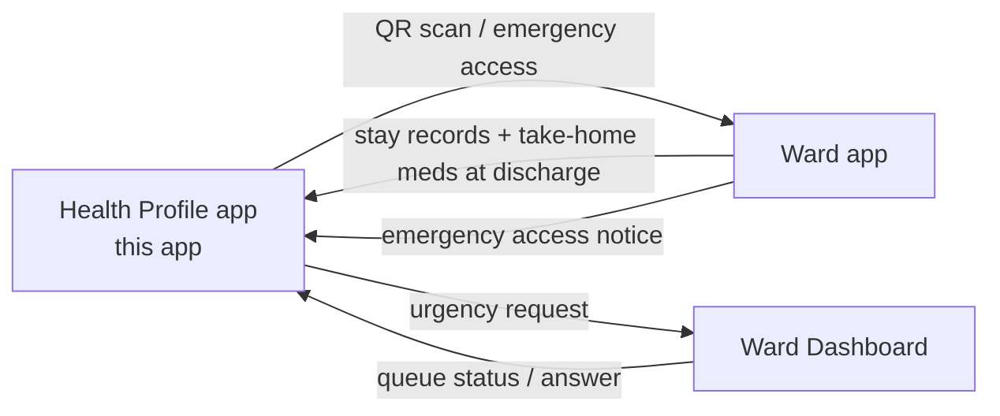
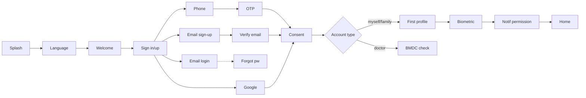
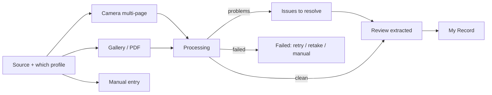

# MedGuard Health Profile — Build Plan

> App 1 of 4 · Public app · Phone PWA · 68 main screens + 17 settings screens
> Sister apps: `medguard-ward` · `medguard-ward-dashboard` · `medguard-admin-console`

---

## 1. At a glance

| | |
|---|---|
| **What it is** | One personal health record per person. Upload prescriptions/reports, AI reads them, user confirms, the app builds a clean profile |
| **Who uses it** | Patients · family caregivers · private chamber doctors (after BMDC check) |
| **Device** | Phone only, 360–430 px wide. Installable PWA |
| **Offline** | View profile, reports, reminders offline. Upload + AI need internet |
| **Languages** | Bangla + English, picked on first launch, switchable any time |
| **Theme** | Light only, bluish, same as the other 3 apps (section 4) |
| **Money** | Free + Premium (more family profiles, unlimited AI chat + similar searches, more storage) |

**What it does, in one line each**

- 📸 **Upload** — camera (many pages), gallery, PDF, or type it in
- 🤖 **AI reads** — extracts conditions, medicines, results; flags problems; the **user confirms**
- 🗂 **My Record** — only sections that have data; AI nudges for important missing items (skippable)
- 💊 **Medicines** — reminders with Taken / Skipped / Snooze log
- 💬 **Ask AI** — explains *your own* reports in plain words. Never diagnoses
- 🔍 **Similar cases** — published cases like yours, with safeguards
- 🔳 **QR share** — hospitals and doctors open your profile by scanning
- 👨‍👩‍👧 **Family** — manage relatives' profiles; relatives can co-manage
- 🩺 **Doctor mode** — verified doctors view shared profiles and add prescriptions

---

## 2. How it connects to the other apps



In this frontend build, all of that is **mocked**. Hospital events arrive from the mock layer (section 9) and the Dev panel.

---

## 3. Build setup (instructions)

- **Stack:** React + Vite + TypeScript + Tailwind CSS v4.
- **Libraries (only these):** `react-router-dom` (routes), `lucide-react` (icons), `recharts` (trend charts), `qrcode.react` (show QR), `vite-plugin-pwa` (install + offline cache). Nothing else unless a screen truly can't be built without it. Plus `gsap` + `@gsap/react` for animation and parallax (see root README).
- **State:** React context + `localStorage`. No Redux/Zustand.
- **i18n:** two dictionary files `src/i18n/en.json` and `src/i18n/bn.json` + a small `t()` hook. No i18n library. Every visible string goes through `t()`.
- **Camera capture (H20):** `<input type="file" accept="image/*" capture="environment" multiple>`. Fake edge detection with a frame overlay. Blur warning is mocked.
- **Biometric (H14, H16):** mock — show the prompt UI, accept on tap.
- **Folder layout:**

```
src/
  app/          routes.tsx, layout (top profile switcher + bottom nav)
  screens/      one folder per area: onboarding, home, upload, record,
                medicines, ai, similar, share, family, doctor, premium,
                notifications, settings
  components/   shared UI (section 5)
  mock/         JSON data + api.ts (fake latency)
  i18n/         en.json, bn.json
  dev/          DevPanel.tsx
```

- **Routing rule:** each screen ID gets one route (section 6). Sheets/dialogs (H52, H60, H33) open over the current route.
- **Fake API:** `mock/api.ts` returns promises with 300–800 ms delay so loading skeletons are visible. A Dev-panel toggle forces errors.

---

## 4. Theme (same in all 4 apps)

Put these tokens in `src/index.css` under Tailwind v4 `@theme`, and use only these:

```css
--primary-700:#174C99; --primary-600:#1D5FBF; --primary-100:#D6E6FB; --primary-50:#EAF2FD;
--page:#F5F8FC; --surface:#FFFFFF;
--ink-900:#0F1B2D; --ink-700:#475467; --ink-500:#5B6B80;
--border-input:#7B8BA1; --border-subtle:#E3E9F1;
--danger-text:#B42318;  --danger-bg:#FEF3F2;  --danger-border:#FDA29B;
--warning-text:#B54708; --warning-bg:#FFFAEB; --warning-border:#FEC84B;
--check-text:#93370D;   --check-bg:#FEF0C7;
--success-text:#067647; --success-bg:#ECFDF3; --success-border:#75E0A7;
--neutral-text:#344054; --neutral-bg:#F2F4F7;
--font: 'Noto Sans','Noto Sans Bengali',system-ui,sans-serif;
radius: 8 controls · 12 cards · 16 sheets/dialogs · full for chips/avatars
spacing: 4 8 12 16 24 32 48 64 only
shadow-bar: 0 1px 3px rgba(15,27,45,.08) · shadow-float: 0 8px 24px rgba(15,27,45,.12)
```

**Rules that matter most for this app**

- White cards (1 px `border-subtle`, no shadow) on `page` background. Shadows only on sheets, dialogs, sticky bars.
- Blue = brand/action only. Other colours = status only. **Status = colour + icon + word**, always.
- Type: Body 16/24 (Bangla 17/28). H1 24, H2 20, H3 18. Names, drugs, doses, allergies ≥ 16 px semibold. Tabular numbers for doses/times/values.
- Buttons 48 px tall, full width in forms. One primary button per screen. Labels are verbs ("Confirm all", never "OK").
- Touch targets ≥ 48 px. Inputs: label above, unit inside right.
- Tone: warm, simple, short. Only H43 is direct: "See a doctor now. Call 999."
- Dates "25 Nov 2026", times "8:00 AM". **Doses/vitals/times in English digits even in Bangla mode** (⚠️ DEFAULT).
- Fonts: load Noto Sans + Noto Sans Bengali from Google Fonts.
- Text must survive 200% scaling (S9). Respect reduce-motion.

---

## 5. Layout and shared components

### Phone shell

```
┌──────────────────────────────┐
│ [👤 Arif ▾]  MedGuard    🔔  │  ← profile switcher (always shows whose profile)
├──────────────────────────────┤
│ ⚠ Offline. Viewing saved data│  ← offline banner (only when offline)
│                              │
│         screen content       │
│                              │
├──────────────────────────────┤
│ 🏠    📋    ( + )    💬   ☰  │  ← 64 px bottom nav, icon + label
│ Home Record Upload  AskAI Menu│    Upload is raised centre button
└──────────────────────────────┘
```

**Menu holds:** Similar cases · Medicines · Share & access · Family · Notifications · Premium · Settings · Help. In doctor mode, add "Doctor home".

### Components to build once, reuse everywhere

| Component | Notes |
|---|---|
| `ProfileSwitcher` + `ProfileSheet` (H52) | Avatar + name at top; sheet lists self + family |
| `BottomNav` | 5 items, active = blue on `primary-100` pill |
| `AllergyStrip` | Red tint + warning icon + "Allergies: Penicillin". If none: neutral "No known allergies". **Never blank** |
| `SourceLabel` | Caption + icon: "Uploaded by you, 12 Nov 2026" / "Added by Dr. Karim" / "From Shanti Hospital" |
| `AiField` | Shows amber "AI read: check this" tag until confirmed; low-confidence = `check-bg` + dashed border + icon; "View original" |
| `StatusChip` | Pill, icon + word: Taken, Skipped, Missed, Due now, Next, Processing, Verified |
| `Card`, `Button` (primary/secondary/tertiary/destructive), `Input`, `Sheet`, `ConfirmDialog` (title = action, reason field when needed, Cancel left) |
| `OfflineBanner` | "Offline. 2 uploads waiting" → green "All synced" for 3 s |
| `Skeleton`, `EmptyState` (one line + one action), `ErrorState` (what happened, Retry) |
| `TrendChart` | Line chart, normal range as `primary-50` band, out-of-range points red with value |
| `LimitSheet` (H60) | Free-limit hit: Upgrade or wait |

---

## 6. Screens (68 + settings)

Legend: 🔒 = needs internet · 📴 = works offline · ⭐ = critical, ≤ 2 taps from Home

### A. First launch and sign-in (16)



| ID | Route | Screen | What's on it / behaviour |
|---|---|---|---|
| H1 | `/` | Splash | Logo, loading, offline check. Returning user → H16 |
| H2 | `/start/language` | Language | Two large buttons: বাংলা / English |
| H3 | `/start/welcome` | Welcome | 3 swipe slides: one health record · similar cases · your data is private. Skip |
| H4 | `/auth` | Sign in or sign up | Continue with phone / email / Google |
| H5 | `/auth/phone` | Phone number | `+880` prefilled, number field, Send code |
| H6 | `/auth/otp` | OTP | 6 boxes, resend timer (60 s), Change number. Mock code: `123456` |
| H7 | `/auth/email/signup` | Email sign-up | Name, email, password + strength meter |
| H8 | `/auth/email/login` | Email login | Email, password, Forgot password |
| H9 | `/auth/forgot` | Forgot password | 3 states: enter email → "link sent" → set new password |
| H10 | `/auth/verify-email` | Verify email | Waiting state, Resend, Open mail app |
| H11 | `/start/consent` | Consent | 4 separate checkboxes: terms, privacy, health-data processing, AI processing. Each with plain-language summary + link. Continue disabled until first 3 ticked; AI optional (if off, AI features show "Turn on AI processing") |
| H12 | `/start/account-type` | Account type | "For myself / my family" or "I'm a doctor" → J1 |
| H13 | `/start/profile` | Create first profile | Name, DOB, sex, photo (optional), blood group (optional) |
| H14 | `/start/biometric` | Biometric setup | Enable / Not now |
| H15 | `/start/notifications` | Notification permission | Explains why (reminders, access alerts), then browser prompt |
| H16 | `/lock` | App lock | Biometric or PIN on return. Keeps unsaved input |

### B. Home (2)

| ID | Route | Screen | What's on it |
|---|---|---|---|
| H17 | `/home` | Home | Next medicine reminder card ⭐ · documents still processing · "Complete your profile" AI prompts (each dismissible) · quick actions: Upload, **Show my QR** ⭐, Ask AI, Similar cases · recent activity |
| H18 | `/home` (variant) | Home, admitted / waiting | Same + **hospital card**. Admitted: hospital, ward, bed, since. Waiting: hospital, queue position/status, **Request urgent review** → sheet with reason field → "Sent. Ward staff will decide." Shows staff answer when it arrives |

```
┌──────────────────────────────┐
│ Good morning, Arif           │  Display 28
│ ┌──────────────────────────┐ │
│ │ 💊 Next: Metformin 500 mg│ │  Info tint
│ │ 8:00 AM · after food     │ │
│ │ [ Taken ]  Snooze        │ │
│ └──────────────────────────┘ │
│ ┌──────────────────────────┐ │
│ │ 🏥 Shanti Hospital        │ │  H18 only
│ │ Neuro Ward B · Bed 7      │ │
│ └──────────────────────────┘ │
│ [Upload] [My QR] [Ask AI] [Similar] │
│ Complete your profile  ✕     │
│  Add blood group?  [Add]     │
│ Recent activity …            │
└──────────────────────────────┘
```

### C. Upload and AI extraction (7) 🔒



| ID | Route | Screen | What's on it |
|---|---|---|---|
| H19 | `/upload` | Upload source | Camera, Gallery, PDF, Type it in. "This is for: [profile ▾]" |
| H20 | `/upload/camera` | Camera capture | Multi-page, edge frame, page counter, thumbnails strip (retake, drag to reorder), blur warning |
| H21 | `/upload/:batchId` | Processing | Progress per document. "You can leave — we'll notify you." |
| H22 | `/upload/:batchId/issues` | Issues to resolve | One card per problem: **Duplicate** (keep which) · **Different name found** (mine / family member's ▾ / not mine) · **Unreadable** (retake) · **Conflicting medicines** (which are you taking now?) |
| H23 | `/upload/:batchId/review` | Review extracted data | Original image on top (tap to zoom), extracted fields below as `AiField`s; low-confidence highlighted; edit any; **Confirm all** |
| H24 | `/record/add` | Manual entry | Type picker: condition, allergy, medicine, vital, surgery, vaccination → one form. Source = "Entered by you" |
| H25 | `/upload/:batchId/failed` | Processing failed | Reason, Retry, Retake photo, Enter manually |

### D. My Record (8) 📴

| ID | Route | Screen | What's on it |
|---|---|---|---|
| H26 | `/record` | Record overview | Header (photo, name, age, sex, blood group) · `AllergyStrip` · sections **only if they have data**: conditions, current medicines, test results, imaging, prescriptions, vitals, surgeries & admissions, vaccinations, family & lifestyle, doctors seen · AI "Add this?" prompts for missing important items (skippable) |
| H27 | `/record/:section` | Section list | All items in section, filter by date + type, each with `SourceLabel` |
| H28 | `/record/tests/:id` | Test result detail | Value, reference range, `TrendChart` over time, source document link |
| H29 | `/documents/:id` | Document viewer | Original image/PDF, extracted data, source label, date. Share, Delete, Re-read with AI 🔒 |
| H30 | `/record/items/:id/edit` | Edit item | Form + change history (who, when, old → new) |
| H31 | `/timeline` | Timeline | Every event, date order, all sources, icon per type |
| H32 | `/admissions/:id` | Admission detail | Hospital, dates, discharge summary, meds + results from the stay |
| H33 | dialog on H32 | Delete hospital record | Warning: doctors may rely on it; reason optional; destructive confirm |

### E. Medicines and reminders (5) 📴

| ID | Route | Screen | What's on it |
|---|---|---|---|
| H34 | `/medicines` | Medicines | Tabs Current / Past; each: name, dose, next time, status chip |
| H35 | `/medicines/:id` | Medicine detail | Dose, timing, before/after food, prescribed by, start/end, source document |
| H36 | `/medicines/:id/reminder` | Reminder setup | Times, days, duration, sound; toggle "Tell caregivers if missed" |
| H37 | `/reminders/:doseId` | Reminder action | From notification: **Taken** ⭐ / Skip (reason) / Snooze (10/30/60 min) |
| H38 | `/medicines/:id/log` | Taken log | Month calendar, each day: Taken ✓ green / Skipped – neutral / Missed ✕ red (icon + word in legend) |

### F. Ask AI (2) 🔒

| ID | Route | Screen | What's on it |
|---|---|---|---|
| H39 | `/ai` | Chat | Scoped to open profile (shown at top). Suggested questions chips. Every answer cites the report ("From: CBC, 12 Nov 2026"). If question needs a doctor → info note "Talk to a doctor about this". Free plan counter "7 of 20 left this month" |
| H40 | `/ai/history` | Chat history | Past chats, search, swipe/delete |

Mock AI: canned answers matched by keyword; never output a diagnosis.

### G. Similar cases (6) 🔒

| ID | Route | Screen | What's on it |
|---|---|---|---|
| H41 | `/similar/disclaimer` | Disclaimer | First time only: not a diagnosis; published cases may differ. Must tick + Accept |
| H42 | `/similar` | Search setup | Toggles: conditions, results, medicines to use. Free counter "1 of 3 left" |
| H43 | banner on H44 | Urgent-sign warning | If profile has danger signs: red card on top "See a doctor now. Call 999" + call button + Nearest hospital |
| H44 | `/similar/results` | Results | Cards: match reasons (chips), age, sex, main condition. **Outcome collapsed** |
| H45 | `/similar/cases/:id` | Case detail | Summary, treatment, outcome behind **Show outcome**, source citation (PMC-Patients), Share with doctor, Save |
| H46 | `/similar/saved` | Saved cases | Per profile |

### H. Share and access (5)

| ID | Route | Screen | What's on it |
|---|---|---|---|
| H47 | `/share/qr` | My QR code ⭐ | White full screen, QR ≥ 280 px, try Screen Wake Lock, name + expiry countdown, Refresh |
| H48 | `/share/doctor` | Share with a doctor | Pick doctor or create link; duration (1 h / 24 h / 7 days); which sections (checkboxes) |
| H49 | `/share/access` | Who has access | Hospitals, doctors, caregivers now; Revoke (confirm) |
| H50 | `/share/log` | Access log | Every view/edit: who, when; emergency access rows marked red |
| H51 | `/share/emergency/:id` | Emergency access notice | Hospital, staff name, time, stated reason; **Report misuse** |

### I. Family and caregivers (5)

| ID | Route | Screen | What's on it |
|---|---|---|---|
| H52 | sheet | Profile switcher | Self + family, current ticked, "Manage family" |
| H53 | `/family` | Family | All managed profiles, "2 of 2 on Free plan" |
| H54 | `/family/add` | Add family member | Create new profile **or** link existing by invitation (phone) |
| H55 | `/family/:profileId/caregivers` | Caregivers | Invite by phone; permission View only / Manage; Remove |
| H56 | `/invites/:id` | Caregiver invitation | Accept / Decline managing someone's profile |

### J. Doctor mode (6)

| ID | Route | Screen | What's on it |
|---|---|---|---|
| J1 | `/doctor/verify` | BMDC verification | Name + BMDC number → auto-check (mock). Pass → J2. Fail → "Account stays a normal user account", Retry |
| J2 | `/doctor` | Doctor home | Patients who shared with me, **Scan QR**, recent patients |
| J3 | `/doctor/scan` | Scan QR | Camera viewfinder (mock: "Simulate scan" button). After scan: "Access for 24 hours" |
| J4 | `/doctor/patients/:id` | Patient profile, doctor view | Full record (same components as H26), similar cases, Add prescription |
| J5 | `/doctor/patients/:id/add` | Add prescription or note | Photo or typed. Patient sees "Added by Dr. X" |
| J6 | `/doctor/profile` | My doctor profile | Name, BMDC, specialty, chamber address |

### K. Premium (4)

| ID | Route | Screen | What's on it |
|---|---|---|---|
| H57 | `/premium` | Plans | Free vs Premium comparison table (section 10 defaults) |
| H58 | `/premium/checkout` | Checkout | bKash / Nagad / Card radio, confirm (mock success) |
| H59 | `/premium/subscription` | Subscription | Plan, renewal date, receipts, Cancel (confirm) |
| H60 | sheet | Limit reached | Which limit, when it resets, Upgrade / Not now |

### L. Notifications (2)

| ID | Route | Screen | What's on it |
|---|---|---|---|
| H61 | `/notifications` | Inbox | Reminders, processing done, access alerts, hospital updates |
| H62 | `/settings/notifications` | Notification settings | Same screen as S10. Access + emergency-access alerts locked ON (lock icon + "Can't be turned off") |

### S. Settings and account (17)

| ID | Route | Screen | What's on it |
|---|---|---|---|
| S1 | `/settings` | Settings home | Grouped list of all below |
| S2 | `/settings/personal` | Edit personal info | Name, photo, DOB, sex |
| S3 | `/settings/phone` | Change phone | OTP to old, then new number |
| S4 | `/settings/email` | Change email | New email + verify |
| S5 | `/settings/password` | Change password | Current, new, confirm |
| S6 | `/settings/sign-in` | Sign-in methods | Phone / email / Google; at least one stays (last one's Remove disabled) |
| S7 | `/settings/security` | Security | Biometric, auto-lock time, change PIN, devices + Log out |
| S8 | `/settings/language` | Language | বাংলা / English |
| S9 | `/settings/text-size` | Text size | 4 sizes with live preview |
| S10 | `/settings/notifications` | Notifications | = H62 |
| S11 | `/settings/privacy` | Privacy and consents | Consents + dates; withdraw AI processing |
| S12 | `/settings/export` | Download my data | Email or save file (mock) |
| S13 | `/settings/delete` | Delete account | What is deleted, what happens to family + caregivers, 30-day grace (⚠️ DEFAULT), OTP confirm |
| S14 | `/help` | Help and FAQ | Search, answers, short videos |
| S15 | `/help/contact` | Contact support | Describe + attach screenshot |
| S16 | `/about` | About and legal | Terms, privacy, licences, version |
| S17 | dialog | Log out | Confirm; warns if unsynced actions |

---

## 7. Key flows to click through end-to-end

1. **Build profile:** H17 → Upload → H19 (pick "Mother") → H20 (3 pages) → H21 → H22 (resolve 1 duplicate + 1 name mismatch) → H23 Confirm all → H26 shows new sections.
2. **Similar cases:** Menu → H41 accept → H42 → H44 (with H43 banner for mother's profile) → H45 Show outcome → Share with doctor.
3. **Waiting list:** H18 waiting card → Request urgent review → reason → later notification "Priority raised" (Dev panel).
4. **Hospital stay:** Dev panel "Admit" → H18 admitted card → Dev panel "Discharge" → H32 new admission + take-home meds appear in H34 with reminders.
5. **Emergency access:** Dev panel → high notification → H51 → Report misuse.
6. **Doctor:** sign up as doctor → J1 pass → J2 → J3 simulate scan → J4 → J5 add note → switch to patient account → note shows "Added by Dr. Karim".

---

## 8. Roles inside this app

| Action | Owner | Caregiver (Manage) | Caregiver (View) | Outside doctor | Hospital (stay) |
|---|---|---|---|---|---|
| View full record | ✓ | ✓ | ✓ | ✓ while shared | ✓ until discharge |
| Upload and edit | ✓ | ✓ | — | Prescriptions + notes | Adds stay records |
| Delete records | ✓ | ✓ | — | — | — |
| Share / revoke | ✓ | ✓ | — | — | — |
| Manage caregivers | ✓ | — | — | — | — |
| Request urgent review | ✓ | ✓ | — | — | — |
| Delete account | ✓ | — | — | — | — |

Hide (don't disable) actions the current role can't do. For View-only caregivers, show a small "View only" chip in the header.

---

## 9. Data and mock (keep it small)

Define TypeScript types in `src/mock/types.ts` for: `Account`, `Profile`, `Allergy`, `Condition`, `Medicine`, `DoseLog`, `TestResult`, `Document`, `UploadBatch` (+ `Issue`), `Admission`, `AccessGrant`, `AccessLogEntry`, `Caregiver`, `ChatThread`, `SimilarCase`, `Notification`, `Subscription`.

Every record item carries `source: { kind: 'self'|'doctor'|'hospital'|'ai', by: string, at: ISODate }` and AI items carry `confidence` + `confirmed`.

**Mock cast (use the same people in all 4 apps):**

| Who | Detail |
|---|---|
| Arif Hasan, 34 M | Account owner. Allergies: none. Metformin 500 mg |
| Rahima Begum, 62 F | Arif's mother, family profile. **Allergy: Penicillin**. Stroke, diabetes. In hospital: Shanti Hospital, Neuro Ward B, **Bed 7**, patient ID 1042 |
| Nasrin Akter, 30 F | Arif's sister, caregiver (Manage) on Rahima |
| Dr. Karim Hossain | Verified doctor, BMDC A-12345, neurology |

Seed: ~6 documents, 2 admissions, 4 medicines (doses due around *now* so Home looks alive), 3 test series with trends, 5 similar cases.

**Dev panel** (floating button, dev builds only): toggle offline · force API errors · simulate admit / waiting / discharge · send emergency access · fire medicine reminder · answer urgency request · switch role (owner / caregiver view / doctor) · reset mock data.

---

## 10. Defaults for open items (⚠️ change later)

| Open item | Default used |
|---|---|
| Digits in Bangla mode | English digits for doses, vitals, times |
| QR access length | Hospital: until discharge. Outside doctor: 24 h (user can pick 1 h / 24 h / 7 days) |
| Free vs Premium | Free: 2 profiles, 20 AI chats/mo, 3 similar searches/mo, 500 MB. Premium (BDT 149/mo): 8 profiles, unlimited chat + searches, 10 GB |
| Payment | bKash, Nagad, card |
| Account deletion | 30-day grace, cancel anytime. Hospitals keep their own copy of stay records |
| BMDC check | Mocked: numbers starting `A-` pass, others fail |
| Drug safety | Allergy conflict warning only |
| New patient without phone | Printed QR card at discharge + SMS link to a relative |

---

## 11. Every screen in every state

Loading (skeleton) · Empty (one line + one action) · Error (what + Retry + what was saved) · Offline (banner; online-only actions greyed with reason) · Permission denied (camera/mic/notifications → why + Open settings) · No access ("View only — ask Arif") · Session locked (H16, keep input) · Free limit (H60) · Forced update · Maintenance.

---

## 12. Build order

1. Theme tokens, fonts, components (section 5), i18n, shell + bottom nav, mock API, Dev panel
2. A. Onboarding + auth → B. Home
3. D. My Record (read-only first) → C. Upload + review
4. E. Medicines + reminders
5. H. Share/QR + I. Family
6. F. Ask AI + G. Similar cases
7. J. Doctor mode → K. Premium → L. Notifications → S. Settings
8. PWA offline cache, states pass, Bangla pass

## 13. Done when

- [ ] All 68 + 17 screens reachable, flows in section 7 work end-to-end
- [ ] Every screen: loading, empty, error, offline designed
- [ ] Allergy strip on every profile view, never blank
- [ ] Every AI field tagged until confirmed; every item has a source label
- [ ] Status always colour + icon + word
- [ ] Full Bangla + English; switching doesn't break layout
- [ ] One primary button per screen; targets ≥ 48 px; text OK at 200%
- [ ] Installs as PWA; record, medicines, reminders open offline
