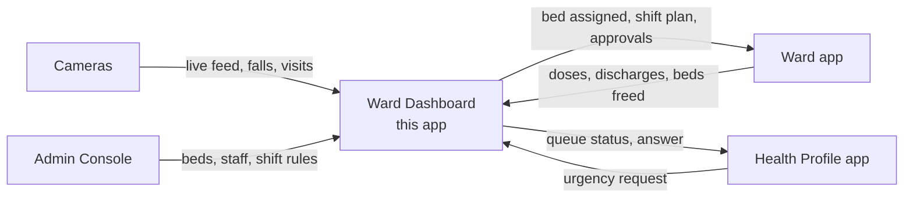
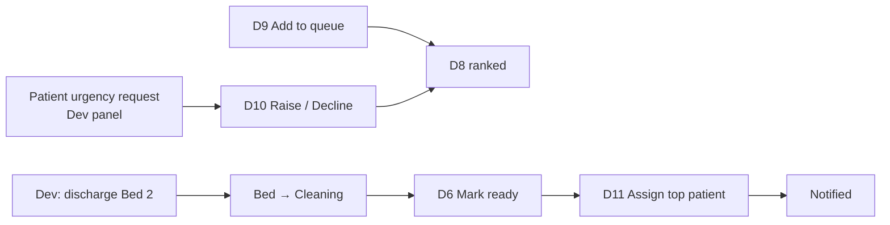

# MedGuard Ward Dashboard — Build Plan

> App 3 of 4 · Ward manager desktop web · 21 screens
> Sister apps: `medguard-health-profile` · `medguard-ward` · `medguard-admin-console`

---

## 1. At a glance

| | |
|---|---|
| **What it is** | The ward manager's live control room: bed map, camera wall, waiting queue, staff, shifts, incidents, reports |
| **Who uses it** | Ward manager (all screens) · Admission desk (**queue screens only**: D1, D8–D11) |
| **Device** | Desktop browser, 1280–1920 px. No wall TV. (The phone version lives in the Ward app, W55–W58) |
| **Offline** | Runs on the hospital network; shows "Hospital server unreachable" if it drops |
| **Languages** | Bangla + English |
| **Theme** | Light only, bluish, identical to the other 3 apps |

**What it does**

- 🗺 **Overview** — bed map by status, live alert feed, staff on duty, today's numbers
- 📹 **Camera wall** — all feeds with AI boxes + bed IDs, faces blurred, event markers
- 🛏 **Beds + queue** — who gets the next freed bed, why they're ranked there, override with a reason
- 🙋 **Urgency requests** — patients ask from their app; manager raises priority or declines with a reason
- 👩‍⚕️ **Staff + shifts** — assign beds to nurses by drag, AI-proposed week plan with rule warnings
- 📊 **Incidents + reports** — fall response times, dose compliance, pilot before/after metrics

---

## 2. How it connects



All mocked in this build.

---

## 3. Build setup (instructions)

- **Stack:** React + Vite + TypeScript + Tailwind CSS v4.
- **Libraries (only these):** `react-router-dom`, `lucide-react`, `recharts` (reports, compliance). Drag and drop with **native HTML5 drag events** (D13, D14) — no dnd library. Plus `gsap` + `@gsap/react` for animation and parallax (see root README).
- **State:** React context + `localStorage` for UI prefs only.
- **i18n:** `en.json` + `bn.json` + small `t()` hook.
- **Live feel:** mock layer emits events on a timer (`setInterval`) — new alerts, nurse visits, bed status changes — so the overview moves.
- **Camera feeds:** static ward images + SVG overlay boxes (bed ID only), CSS blur over face regions, small "LIVE" + timestamp.
- **Export (D19):** CSV via `Blob` download; PDF via `window.print()` with a print stylesheet. No PDF library.
- **Session:** auto-lock after 5 min idle on shared PCs → PIN.
- **Folder layout:**

```
src/
  app/         routes.tsx, Shell (sidebar + top bar + alerts panel), RoleGate
  screens/     login, overview, camera, beds, queue, staff, shifts,
               incidents, reports, patients, approvals
  components/  section 5
  mock/        JSON + api.ts + liveEvents.ts
  i18n/  dev/
```

---

## 4. Theme (same in all 4 apps)

Tokens in `src/index.css` under Tailwind v4 `@theme`:

```css
--primary-700:#174C99; --primary-600:#1D5FBF; --primary-100:#D6E6FB; --primary-50:#EAF2FD;
--page:#F5F8FC; --surface:#FFFFFF;
--ink-900:#0F1B2D; --ink-700:#475467; --ink-500:#5B6B80;
--border-input:#7B8BA1; --border-subtle:#E3E9F1;
--danger-text:#B42318;  --danger-bg:#FEF3F2;  --danger-border:#FDA29B;
--warning-text:#B54708; --warning-bg:#FFFAEB; --warning-border:#FEC84B;
--check-text:#93370D;   --check-bg:#FEF0C7;
--success-text:#067647; --success-bg:#ECFDF3; --success-border:#75E0A7;
--neutral-text:#344054; --neutral-bg:#F2F4F7;
--font: 'Noto Sans','Noto Sans Bengali',system-ui,sans-serif;
radius: 8 controls · 12 cards · 16 dialogs · full chips
spacing: 4 8 12 16 24 32 48 64 only
shadow-bar: 0 1px 3px rgba(15,27,45,.08) · shadow-float: 0 8px 24px rgba(15,27,45,.12)
```

**Desktop rules**

- 12-column grid, 24 px gutters, 32 px page padding, max content 1440 px.
- Buttons 40 px. Tables: 48 px rows, sticky header, no zebra, `primary-50` hover, sortable headers, filters above, pagination below.
- Body 16, table cells Small 14. Big numbers (stat tiles) Display 28 bold, tabular figures.
- Status = colour + icon + word, always.
- Tone: clinical, short.

**Bed status (use everywhere)**

| Status | Style | Icon |
|---|---|---|
| Occupied | Info (blue tint) | `bed` |
| Ready | Success | `check-circle` |
| Cleaning | Warning | `sparkles` |
| Reserved | primary-100 | `bookmark` |
| Out of service | Neutral | `ban` |

---

## 5. Layout and shared components

```
┌──────────────┬────────────────────────────────────────────────┬──────────────┐
│ MedGuard     │ Neuro Ward B ▾ · Shanti Hospital · ●Live · 👤 Habib ▾ │  Alerts (3) │
│              ├────────────────────────────────────────────────┤  panel 360px │
│ ▌Overview    │                                                │  slides in   │
│  Camera      │                page content                    │  from right  │
│  Beds        │                                                │  on any page │
│  Queue       │                                                │              │
│  Staff       │                                                │              │
│  Shifts      │                                                │              │
│  Incidents   │                                                │              │
│  Reports     │                                                │              │
│  Patients    │                                                │              │
│  Approvals   │                                                │              │
└──────────────┴────────────────────────────────────────────────┴──────────────┘
   248 px sidebar (active: primary-50 bg, primary-700 text, 3 px blue bar left)
```

Admission desk sees only **Queue** in the sidebar.

| Component | Notes |
|---|---|
| `Sidebar`, `TopBar` (ward switcher, live status, user), `AlertsPanel` (right drawer, tiers, acknowledge) |
| `StatTile` | Label + big number + small trend ("Free beds 2") |
| `BedTile` | Bed number, status chip, patient ID (not name on camera-related views), time in status |
| `CameraTile` | Feed + boxes + bed IDs + event markers; click → D5 |
| `DataTable` | Sort, filter bar, pagination, row click |
| `PriorityBadge` | P1 Emergency (danger) · P2 Urgent (warning) · P3 Routine (neutral) |
| `ReasonDialog` | Confirm + required reason (override, decline, assign) |
| `FallAlarm` | Critical full-screen overlay, same as Ward app — manager receives on escalation |
| `Skeleton`, `EmptyState`, `ErrorState`, `ServerBanner` |

---

## 6. Screens (21)

### Access

| ID | Route | Screen | What's on it |
|---|---|---|---|
| D1 | `/login` | Login | Phone + OTP (mock `123456`), then PIN; session times out on shared PCs |
| D2 | `/ward` | Choose ward | For managers covering > 1 ward |

### Live

| ID | Route | Screen | What's on it |
|---|---|---|---|
| D3 | `/` | Overview | Stat tiles (free beds, open alerts, doses on time %) · bed map by status · live alert feed · staff on duty |
| D4 | `/camera` | Camera wall | Grid of feeds (2×1, 2×2, 3×3 toggle), AI boxes + bed IDs, faces blurred, event markers |
| D5 | `/camera/:camId` | Single camera | One feed large + event list (falls, nurse visits) with snapshots; click event → jump |

```
D3 Overview
┌─────────┬─────────┬─────────┬─────────┐
│Free beds│Open     │Doses on │Staff on │
│   2     │alerts 3 │time 91% │duty 4   │
├─────────┴─────────┴─────────┼─────────┤
│ Bed map                      │ Live    │
│ [1 Occ][2 Occ][3 Ready]      │ alerts  │
│ [4 Occ][5 Occ][6 Clean]      │ 🔴 Fall │
│ [7 Occ][8 Occ][9 Occ][10 OOS]│ 🟠 Over-│
├──────────────────────────────┤  due    │
│ Staff on duty: Rina (6 beds, 1 overdue) │
└──────────────────────────────┴─────────┘
```

### Beds and queue

| ID | Route | Screen | What's on it |
|---|---|---|---|
| D6 | `/beds` | Bed board | Every bed: status chip, time in status; filter by status; Mark ready |
| D7 | `/beds/:bedId` | Bed detail | Current patient, history, cleaning log, mapped camera |
| D8 | `/queue` | Waiting queue | Ranked table: rank, patient, priority, hours waiting, booking time, bed type, **urgency request flag** · "Why here?" expandable (score breakdown) · Override (reason) |
| D9 | `/queue/add` | Add to queue | Scan Health Profile QR or enter details · priority · source (emergency / OPD / referral) · bed type |
| D10 | `/queue/requests` | Urgency requests | Patient's reason · Raise priority / Decline (reason required — patient sees answer) |
| D11 | `/queue/assign/:bedId` | Assign bed | Freed bed matched to top patient · Confirm or pick another (reason) · patient + desk notified |

```
D8 Waiting queue
┌────┬────────────────┬──────────┬───────┬──────────┬────────┬─────────┐
│ #  │ Patient        │ Priority │ Wait  │ Booked   │ Bed    │         │
├────┼────────────────┼──────────┼───────┼──────────┼────────┼─────────┤
│ 1  │ Jahid Islam    │ P1 Emerg │ 6 h   │ 8:10 AM  │ General│ Why? ▾  │
│ 2  │ Rokeya Sultana │ P2 Urgent│ 14 h  │ Yesterday│ General│ 🙋 Req  │
│ 3  │ Mizanur Rahman │ P3 Routine│ 2 d  │ 23 Nov   │ ICU    │         │
└────┴────────────────┴──────────┴───────┴──────────┴────────┴─────────┘
 Why? → Emergency level 60 + hours waiting 14 + booking 5 = 79
```

### Staff and shifts

| ID | Route | Screen | What's on it |
|---|---|---|---|
| D12 | `/staff` | Staff on duty | Who's in, assigned beds, open tasks, overdue doses per nurse |
| D13 | `/staff/assign` | Assign beds to nurses | Nurse columns; drag patient cards between them; ratio warning if over limit; Save |
| D14 | `/shifts` | Shift planner | Week grid (nurses × days × shifts) · **AI-proposed plan** button · warnings when ratio/rest rules break (danger chip on cell) · drag to change · Publish (confirm) |
| D15 | `/shifts/swaps` | Swap requests | Approve / Decline nurse swaps (decline needs reason) |

### Incidents and reports

| ID | Route | Screen | What's on it |
|---|---|---|---|
| D16 | `/incidents` | Incident log | Falls + missed doses: time, bed, response time, outcome |
| D17 | `/incidents/:id` | Incident detail | Alarm timeline (sent → escalated → acknowledged → resolved) with times, outcome, notes |
| D18 | `/reports/doses` | Dose compliance | On-time / late / missed by nurse, by drug, by time of day (bar charts + table) |
| D19 | `/reports` | Reports | Pilot metrics: bed turnover, doses on time, fall response time · **before vs after** · Export CSV / PDF |

### Patients and approvals

| ID | Route | Screen | What's on it |
|---|---|---|---|
| D20 | `/patients` | Patient directory | Search all ward patients → read-only profile (header + allergy strip + summary) |
| D21 | `/approvals` | Approvals | Medicine approvals; only if manager is also senior nurse (same UI as Ward app W34: image beside lines) |

---

## 7. Key flows to click through



1. **Waiting list → bed:** D9 add → D10 raise a request → Dev "discharge Bed 2" → D6 Cleaning → Mark ready → D11 confirm → toast "Jahid Islam notified".
2. **Override:** D8 drag/override #3 above #2 → ReasonDialog → audit.
3. **Fall review:** Dev "fall Bed 7, no ack" → escalation alarm reaches manager → D16 → D17 timeline.
4. **Shift plan:** D14 AI propose → fix 1 warning by drag → Publish → nurses notified.
5. **Assign beds:** D13 drag Bed 5 from Rina to Mitu → ratio warning clears.

---

## 8. Data and mock (keep it small)

Types: `Bed` (status, since, cameraId), `Camera` (beds, online), `CameraEvent` (fall / visit, bedId, at, snapshot), `Patient` (summary only + allergies), `QueueEntry` (priority, source, bookedAt, bedType, score parts, urgencyRequest?), `UrgencyRequest` (reason, status, answer), `Staff`, `Assignment`, `Shift`, `ShiftRule` (ratio, minRest), `SwapRequest`, `Incident` (timeline[]), `DoseStat`, `Metric` (before/after).

**Mock cast (same in all 4 apps):** Shanti Hospital, Dhaka · Neuro Ward B · 10 beds · CAM-01 (beds 1–5), CAM-02 (6–10).

- Patients: Rahima Begum Bed 7 (Penicillin, high fall risk) · Abdul Malek Bed 2 · Fatema Khatun Bed 5 · + 5 more
- Queue: Jahid Islam (P1), Rokeya Sultana (P2, has urgency request), Mizanur Rahman (P3)
- Staff on duty: Nurse Rina Akter, Nurse Mitu Das, Sister Shahana Parvin (senior), Dr. Karim Hossain (duty doctor)
- Manager: Habib Rahman · Admission desk: Salma Khatun
- 4 weeks of incident + dose history for reports; "before" baseline numbers worse than "after"

**Dev panel:** fall (with/without ack) · discharge a bed · new urgency request · server unreachable · force errors · switch user (manager / admission desk / manager-as-senior-nurse) · reset.

---

## 9. Defaults for open items (⚠️ change later)

| Open item | Default used |
|---|---|
| Queue ranking | Score = emergency level (P1 60 / P2 35 / P3 10) + hours waiting (1 pt/h, max 30) + booking order (0–10). Urgency request **does not add points** — it only flags; manager decides |
| Shift rules | 1 nurse : 6 patients (ward), 11 h minimum rest; editable in Admin Console |
| Digits | English digits for numbers even in Bangla |

---

## 10. States (every screen)

Loading skeleton · Empty ("No one waiting") · Error + Retry · Hospital server unreachable banner · No access (admission desk on non-queue page) · Session locked (PIN, keep input) · Camera offline tile ("CAM-02 offline since 9:14 AM") · Forced update · Maintenance.

## 11. Build order

1. Theme, shell (sidebar, top bar, alerts panel), DataTable, mock + live events, Dev panel
2. D1–D2 → D3 Overview → D6–D7 Beds
3. D8–D11 Queue (+ admission-desk role)
4. D4–D5 Camera
5. D12–D15 Staff + shifts (drag)
6. D16–D19 Incidents + reports → D20–D21
7. Bangla + states pass

## 12. Done when

- [ ] All 21 screens reachable; admission desk sees only queue screens
- [ ] Overview updates live from mock events
- [ ] Every override / decline / publish has confirm + reason and is audited
- [ ] Queue shows *why* each patient is ranked
- [ ] Camera views show bed IDs only, faces blurred
- [ ] Fall escalation reaches the manager as full-screen alarm
- [ ] Bed status always colour + icon + word
- [ ] Works at 1280 and 1920 px; Bangla + English complete
