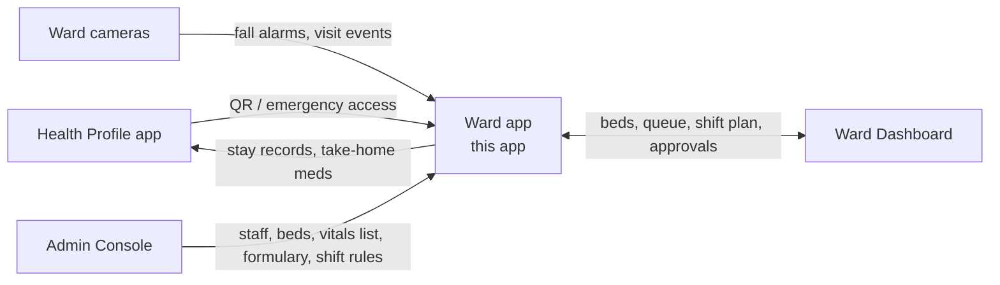
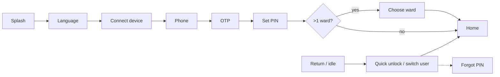
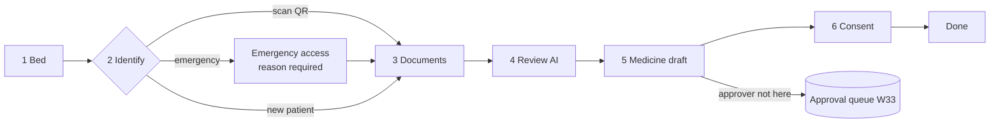
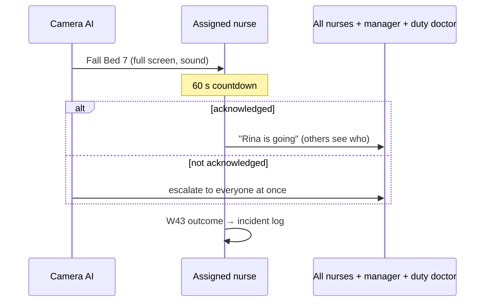

# MedGuard Ward — Build Plan

> App 2 of 4 · Hospital staff app · One responsive PWA (phone, tablet, PC) · 61 main screens + 10 settings screens
> Sister apps: `medguard-health-profile` · `medguard-ward-dashboard` · `medguard-admin-console`

---

## 1. At a glance

| | |
|---|---|
| **What it is** | The ward's working tool: patient list, dose checklist, AI-read prescriptions, vitals, fall alarms, admission → discharge |
| **Who uses it** | Staff nurses · senior nurse (sister-in-charge) · doctors (consultant, MO, intern) · ward manager (phone view) |
| **Devices** | Nurses' own phones, shared ward tablets, nurse-station PCs — **one app, three layouts** |
| **Offline** | Works on hospital Wi-Fi with no internet. Actions queue locally and sync; conflicts are resolved by a person |
| **Languages** | Bangla + English |
| **Theme** | Light only, bluish, identical to the other 3 apps (section 4) |

**What it does**

- 💊 **Dose checklist** — Overdue / Now / Next, give dose in 2 taps, camera shows "Visit seen by camera"
- 📷 **Admission** — scan the patient's Health Profile QR, photograph prescriptions, AI drafts the schedule, **doctor or senior nurse approves**
- 🚨 **Fall alarm** — full-screen to the assigned nurse; after 60 s, everyone
- 🎙 **Command** — type or say "Bed 7 BP 120 by 80" in Bangla or English → confirm card → saved
- 🩺 **Profile** — summary, meds, vitals, reports, timeline, notes, similar cases, patient's own health record
- 🔁 **Shifts & handover** — auto handover summary, swaps
- 🛏 **Discharge** — AI-drafted summary, take-home meds go to the patient's Health Profile

---

## 2. How it connects



All mocked in this build (section 9).

---

## 3. Build setup (instructions)

- **Stack:** React + Vite + TypeScript + Tailwind CSS v4.
- **Libraries (only these):** `react-router-dom`, `lucide-react`, `recharts` (vitals), `vite-plugin-pwa`. Nothing else unless unavoidable. Plus `gsap` + `@gsap/react` for animation and parallax (see root README).
- **State:** React context + `localStorage`. The **offline queue** is a plain array of pending actions in `localStorage`; replay on reconnect.
- **i18n:** `src/i18n/en.json` + `bn.json` + small `t()` hook. Drug names are never translated.
- **Voice (W40, W45):** Web Speech API (`lang: 'bn-BD'` or `'en-US'`) if available, else typed input. Parse with simple regex rules (bed, vital, value, drug, dose, time). Always end at a confirm card.
- **Camera feed (W23, W42):** mock with a static ward image + SVG overlay boxes (bed ID only, faces blurred via CSS blur on a region).
- **QR scan (W25):** viewfinder UI + "Simulate scan" button.
- **Breakpoints:** phone < 768 px · tablet ≥ 768 · PC ≥ 1024. Same routes, different shell.
- **Folder layout:**

```
src/
  app/         routes.tsx, shells (PhoneShell, SidebarShell), RoleGate
  screens/     auth, home, patients, admit, meds, vitals, alerts, command,
               discharge, shifts, manager, sync, me, settings
  components/  section 5
  mock/        JSON + api.ts + offlineQueue.ts
  i18n/  dev/
```

- **Role gating:** one `can(role, action)` function using the table in section 8. Hide what a role can't do.

---

## 4. Theme (same in all 4 apps)

Tokens in `src/index.css` under Tailwind v4 `@theme`:

```css
--primary-700:#174C99; --primary-600:#1D5FBF; --primary-100:#D6E6FB; --primary-50:#EAF2FD;
--page:#F5F8FC; --surface:#FFFFFF;
--ink-900:#0F1B2D; --ink-700:#475467; --ink-500:#5B6B80;
--border-input:#7B8BA1; --border-subtle:#E3E9F1;
--danger-text:#B42318;  --danger-bg:#FEF3F2;  --danger-border:#FDA29B;
--warning-text:#B54708; --warning-bg:#FFFAEB; --warning-border:#FEC84B;
--check-text:#93370D;   --check-bg:#FEF0C7;
--success-text:#067647; --success-bg:#ECFDF3; --success-border:#75E0A7;
--neutral-text:#344054; --neutral-bg:#F2F4F7;
--font: 'Noto Sans','Noto Sans Bengali',system-ui,sans-serif;
radius: 8 controls · 12 cards · 16 sheets/dialogs · full chips/avatars
spacing: 4 8 12 16 24 32 48 64 only
shadow-bar: 0 1px 3px rgba(15,27,45,.08) · shadow-float: 0 8px 24px rgba(15,27,45,.12)
```

**Rules that matter most here**

- Status = colour + icon + word: **Overdue** (danger, clock) · **Due now** (warning) · **Next** (info) · **Given** (success, check) · **Missed** (danger) · **Held** (neutral) · **Awaiting approval** (warning) · **Offline** (warning).
- Patient name, drug, dose, allergies ≥ 16 px semibold. Tabular numbers everywhere.
- Buttons 48 px (phone) / 40 px (PC). **Give dose** and **I am going** = 56 px.
- Staff tone: clinical, precise, short. English digits for doses/vitals/times even in Bangla (⚠️ DEFAULT).
- Honest camera wording: **"Visit seen by camera"** — never "Dose verified".
- Only the fall alarm takes over the screen. Everything else = banner or inbox.

---

## 5. Layout and shared components

### Phone

```
┌──────────────────────────────┐
│ Neuro B · 3h 20m left · ●Synced · 👤 Rina │ ← 56 px top bar, always
├──────────────────────────────┤
│ ⚠ Offline. 3 actions waiting │ ← only when offline
│  content                     │
├──────────────────────────────┤
│ 🏠    👥    (🎙)    🔔3   👤  │ ← Home · Patients · Command · Alerts · Me
└──────────────────────────────┘
```

### Tablet / PC

```
┌───────────┬─────────────────────────────────────────┐
│ MedGuard  │ Neuro B · 3h 20m · ●Synced · 👤 Rina ▾  │
│ ▌Home     ├─────────────────────────────────────────┤
│  Patients │                                         │
│  Command  │   list  │  detail  (two-pane on PC)     │
│  Alerts   │                                         │
│  Beds     │                                         │
│  Camera   │                                         │
│  Me       │                                         │
│ (manager: │                                         │
│ Overview, │                                         │
│ Queue,    │                                         │
│ Shifts)   │                                         │
└───────────┴─────────────────────────────────────────┘
  248 px sidebar
```

Top bar avatar opens **Switch user** (W7) on shared devices.

### Components

| Component | Notes |
|---|---|
| `TopBar` | Ward, shift time left, sync dot + word, avatar + name. Always visible |
| `PatientHeader` | Sticky: photo 48 px, full name (H3), age/sex, large **Bed 7** chip, patient ID. On every patient screen |
| `AllergyStrip` | Directly under header. Red: "Allergies: Penicillin". None: neutral "No known allergies". Never blank |
| `DoseRow` | Time · "Insulin 10 units SC" · Bed + name · status chip · Give button. Overdue sorts first |
| `StatusChip`, `SourceLabel`, `AiField` | As in theme. `AiField` amber "AI read: check this" until confirmed → "Confirmed by Nurse Rina, 8:05 AM" |
| `AlertBanner` (high), `FallAlarm` (critical overlay, global), `Toast` (confirmations only, 4 s) |
| `ConfirmDialog` | Title = action ("Stop insulin?"), consequence, reason field when required |
| `BottomSheet` | Phone quick actions (Give dose); handle, main button at bottom |
| `CameraView` | Mock feed + bed boxes with ID only, blurred faces, event list |
| `VitalsChart` | Normal band `primary-50`, out-of-range red dots with value |
| `ConfirmCard` | For voice/command: "I understood: …" Confirm / Edit / Cancel |
| `OfflineBanner`, `Skeleton`, `EmptyState`, `ErrorState` |

---

## 6. Screens (61 + 10 settings)

⭐ = ≤ 2 taps from Home · 🔐 = role-limited (section 8)

### A. Sign-in and session (9)



| ID | Route | Screen | What's on it |
|---|---|---|---|
| W1 | `/` | Splash | Connect to hospital server; offline state if unreachable |
| W2 | `/language` | Language | বাংলা / English |
| W3 | `/connect` | Connect device | Scan hospital setup QR or type hospital code; register as **Personal** or **Shared** device |
| W4 | `/login` | Login | Phone number (invited staff only; unknown number → "Ask your hospital admin") |
| W5 | `/login/otp` | OTP | Code (mock `123456`), resend timer |
| W6 | `/login/pin` | Set PIN | 6-digit PIN, confirm |
| W7 | `/unlock` | Quick unlock / switch user | Shared: recent staff faces → tap → PIN. Personal: biometric. Keeps unsaved input |
| W8 | `/ward` | Choose ward | Only if assigned to > 1 ward |
| W9 | `/forgot-pin` | Forgot PIN | OTP reset |

Auto-lock after inactivity (default 2 min shared, 5 min personal).

### B. Home — by role (3)

| ID | Route | Screen | What's on it |
|---|---|---|---|
| W10 | `/home` (nurse) | Nurse home | Dose checklist grouped **Overdue / Now / Next** with photo + bed ⭐ · My beds · Handover to acknowledge · shift time left |
| W11 | `/home` (doctor) | Doctor home | **Needs your approval** (AI-read meds, documents) · new results · my patients · alerts on my patients |
| W12 | `/home` (senior nurse) | Senior nurse home | Nurse home + approvals + ward strip (free beds, open alerts, overdue doses) |

```
Nurse home (phone)
┌──────────────────────────────┐
│ Overdue (1)                  │
│ ┌──────────────────────────┐ │ danger tint
│ │🕐 7:30 AM  Bed 2         │ │
│ │ Abdul Malek              │ │
│ │ Amlodipine 5 mg PO       │ │
│ │ ⏰ Overdue 35 min [Give]  │ │
│ └──────────────────────────┘ │
│ Now (2)                      │
│ │ 8:00 AM Bed 7 Rahima B.   │ │
│ │ Insulin 10 units SC [Give]│ │
│ Next (5) …                   │
│ Handover from Nurse Mitu  [Acknowledge] │
└──────────────────────────────┘
```

### C. Patients (11)

| ID | Route | Screen | What's on it |
|---|---|---|---|
| W13 | `/patients` | Patient list | Sorted by bed. Filters: mine, overdue, high fall risk, new results, awaiting approval. Row: photo, name, bed, ID, next dose, chips |
| W14 | `/patients/:id` | Summary | Header + allergy strip · diagnosis · bed priority · fall-risk level · next dose · last visit seen by camera · attending doctor |
| W15 | `/patients/:id/meds` | Medications | Active schedule; day grid (given / late / missed / held); awaiting-approval items marked |
| W16 | `/patients/:id/vitals` | Vitals | Trend charts with abnormal flags; Add vitals |
| W17 | `/patients/:id/reports` | Reports | Prescriptions, tests, imaging this stay |
| W18 | `/patients/:id/timeline` | Timeline | Everything this stay, newest first |
| W19 | `/patients/:id/notes` | Notes | Doctor progress notes, nursing notes, transcribed voice notes |
| W20 | `/patients/:id/similar` | Similar cases 🔐 | Same disclaimer + collapsed outcomes as public app |
| W21 | `/patients/:id/record` | Health record | Patient's own Health Profile history, **read-only**, every item source-labelled |
| W22 | `/documents/:docId` | Document viewer | Original beside extracted data; who confirmed, when |
| W23 | `/patients/:id/camera` | Bed camera 🔐 | Live feed (nurses + manager), faces blurred, recent events |

Patient profile = tabs (W14–W21) under one sticky header. Phone: horizontal scroll tabs. PC: list left, profile right.

### D. Admission and documents (9)



| ID | Route | Screen | What's on it |
|---|---|---|---|
| W24 | `/admit` | 1: Bed | Free beds, or "Next from queue" for this bed |
| W25 | `/admit/identify` | 2: Identify | Scan Health Profile QR · Emergency access · New patient (hospital creates profile, handed to patient's phone later) |
| W26 | `/admit/emergency` | Emergency access 🔐 | Reason required; "This is logged. Patient and caregivers will be notified." |
| W27 | `/admit/documents` | 3: Documents | Multi-page capture of prescriptions + reports |
| W28 | `/admit/review` | 4: Review | AI fields beside originals; low-confidence highlighted |
| W29 | `/admit/medicines` | 5: Medicine draft | Proposed schedule. Doctor/senior nurse: approve now. Others: "Send for approval" |
| W30 | `/admit/consent` | 6: Consent | Patient/guardian consent for camera + data use; signature pad or thumbprint photo |
| W31 | `/admit/done` | Done | Summary; bed now Occupied; camera linked |
| W32 | `/patients/:id/reports/add` | Add report | Capture → AI read → review → attach |

### E. Medicines (6)

| ID | Route | Screen | What's on it |
|---|---|---|---|
| W33 | `/approvals` | Approval queue 🔐 | Pending AI-read + nurse-entered meds, oldest first |
| W34 | `/approvals/:id` | Approve medicines 🔐 | Prescription image beside each extracted line; Approve / Edit / Reject per line; **allergy-conflict warning** (danger banner, must acknowledge) |
| W35 | `/patients/:id/orders/new` | Medicine order 🔐 | Drug (formulary search), dose, unit, route, frequency, times, duration, as-needed, instructions. Intern → draft needing approval |
| W36 | dialog | Stop or hold 🔐 | Reason required; nurse notified |
| W37 | sheet `/doses/:doseId` | Give dose ⭐ | Header + allergy strip · drug, dose, route, due time · **Given** / Given late / **Not given** (refused, nil by mouth, out of stock, vomiting, held by doctor) · "Visit seen by camera 8:03 AM" indicator |
| W38 | `/doses/:doseId/overdue` | Overdue dose | How late, assigned nurse, Give now, or reason |

```
Give dose (bottom sheet)
┌──────────────────────────────┐
│ [photo] Rahima Begum  [Bed 7]│
│ 62 F · ID 1042               │
│ ⚠ Allergies: Penicillin      │ red strip
├──────────────────────────────┤
│ Insulin (Actrapid)           │
│ 10 units · SC · due 8:00 AM  │
│ 👁 Visit seen by camera 8:03 │
│                              │
│ [        Given        ] 56px │ primary
│ [ Given late ] [ Not given ] │
└──────────────────────────────┘
```

### F. Vitals (2)

| ID | Route | Screen | What's on it |
|---|---|---|---|
| W39 | `/patients/:id/vitals/new` | Record vitals | Fields from hospital config (BP, pulse, temp, SpO2, RR, sugar); units inside fields; out-of-range flagged inline; **Notify doctor** |
| W40 | sheet | Voice vitals confirm | "Bed 7: BP 120/80, pulse 88" card → Confirm / Edit |

### G. Alerts (4)

| ID | Route | Screen | What's on it |
|---|---|---|---|
| W41 | `/alerts` | Alerts inbox | Tier filter, open / acknowledged |
| W42 | global overlay | **Fall alarm** ⭐ | Solid red full screen, white text 32 px "Fall: Bed 7", name, time, blurred snapshot, Live view, **I am going** (56 px) / Resolved / False alarm, countdown to escalation. Repeating sound + vibration + pulse icon (1/s) |
| W43 | `/alerts/:id/outcome` | Fall outcome | No injury / Injury (notify doctor) / False alarm; notes → incident log |
| W44 | `/alerts/:id` | Alert detail | Overdue dose or urgent result + its action |



### H. Command assistant (2)

| ID | Route | Screen | What's on it |
|---|---|---|---|
| W45 | `/command` | Command | Type or **hold to talk**, Bangla/English; example chips: "Bed 7 BP 120 by 80", "Bed 7 insulin given", "Show bed 2" |
| W46 | sheet | Confirm card | "I understood: Bed 7, insulin 10 units, given 8:05" → Confirm / Edit / Cancel. **Nothing saved without Confirm** |

### I. Discharge and transfer (4) 🔐

| ID | Route | Screen | What's on it |
|---|---|---|---|
| W47 | `/patients/:id/discharge` | 1: Summary | AI draft from record; doctor edits + signs |
| W48 | `/patients/:id/discharge/meds` | 2: Take-home meds | Sent to patient's Health Profile with reminders |
| W49 | `/patients/:id/discharge/confirm` | 3: Confirm | Destructive confirm + reason. Bed → Cleaning; manager told next patient in queue |
| W50 | `/patients/:id/transfer` | Bed transfer | New bed/ward + reason; camera mapping updates |

### J. Shifts (4)

| ID | Route | Screen | What's on it |
|---|---|---|---|
| W51 | `/shift/start` | Start shift | Confirm ward + assigned beds |
| W52 | `/shift/handover` | Handover | Auto summary: pending doses, new admissions, open alerts. Outgoing reviews → incoming acknowledges |
| W53 | `/shifts` | My shifts | Calendar of upcoming shifts |
| W54 | `/shifts/swap` | Swap request | Pick shift + colleague; manager approves |

### K. Ward manager on phone (4) 🔐

| ID | Route | Screen | What's on it |
|---|---|---|---|
| W55 | `/manager` | Ward overview | Free beds, open alerts, staff on duty |
| W56 | `/manager/beds` | Bed board | Bed statuses; Mark ready. (Nurses see this read-only as "Beds") |
| W57 | `/manager/queue` | Queue | Ranked waiting list; add patient; review urgency requests |
| W58 | `/manager/shift-plan` | Approve shift plan | Review + publish |

### L. Sync (2)

| ID | Route | Screen | What's on it |
|---|---|---|---|
| W59 | `/sync` | Sync status | Actions waiting (list), last synced |
| W60 | `/sync/conflicts/:id` | Resolve conflict | Two versions side by side (e.g. dose marked by two nurses); choose one + reason |

### M. Me (2) + reused settings (10)

| ID | Route | Screen |
|---|---|---|
| W61 | `/me` | My profile: photo, name, role, wards, phone (read-only, managed by admin) |
| W62 | `/settings` | = S1 |
| S2 | `/settings/photo` | Photo only |
| S7 | `/settings/security` | Biometric, auto-lock, change PIN, devices |
| S8 · S9 · S10 | `/settings/language` · `/text-size` · `/notifications` | Critical alerts locked on |
| S14 · S15 · S16 | `/help` · `/help/contact` · `/about` | |
| S17 | dialog | Log out; warns if unsynced actions |

---

## 7. Key flows to click through

1. **Admission → first dose:** W24 Bed 3 → W25 scan → W27 3 pages → W28 → W29 send for approval → switch user to Dr. Karim (W7) → W11 → W34 approve (allergy warning on one line) → switch to Nurse Rina → W10 shows dose → W37 Given + "Visit seen by camera".
2. **Fall:** Dev panel "Fall Bed 7" → W42 on Rina → wait 60 s (Dev: fast-forward) → escalated badge → I am going → W43 No injury.
3. **Voice vitals:** Command → "Bed 7 BP 120 by 80" → W46 → Confirm → W16 chart updated.
4. **Offline:** Dev toggle offline → give 2 doses → banner "2 actions waiting" → Dev "conflict" → back online → W60 resolve.
5. **Discharge:** Dr. Karim → W47 sign → W48 → W49 reason → Bed 2 Cleaning.
6. **Handover:** Dev "end shift" → W52 outgoing review → switch user → incoming acknowledges.

---

## 8. Roles and permissions (⚠️ proposed default)

| Action | Staff nurse | Senior nurse | Doctor | Intern | Ward manager | Admission desk |
|---|---|---|---|---|---|---|
| View patient profiles | ✓ | ✓ | ✓ | ✓ | ✓ | Name + bed only |
| Admit, capture documents | ✓ | ✓ | ✓ | ✓ | — | — |
| Emergency access | — | ✓ | ✓ | — | — | — |
| Approve AI-read meds | — | ✓ | ✓ | — | If senior nurse | — |
| Type medicine orders | — | — | ✓ | Draft only | — | — |
| Stop / hold medicine | — | — | ✓ | — | — | — |
| Give dose, record vitals | ✓ | ✓ | ✓ | ✓ | — | — |
| Live camera | ✓ | ✓ | — | — | ✓ | — |
| Similar cases | ✓ | ✓ | ✓ | ✓ | — | — |
| Discharge | — | — | ✓ | — | — | — |
| Bed transfer | — | ✓ | ✓ | — | ✓ | — |
| Add to queue | — | — | ✓ | — | ✓ | ✓ |
| Set priority / override queue | — | — | ✓ | — | ✓ | — |
| Plan / publish shifts | — | — | — | — | ✓ | — |

---

## 9. Data and mock (keep it small)

Types in `src/mock/types.ts`: `Staff` (role, isSenior, wards), `Ward`, `Bed` (status), `Patient` (+ `Allergy[]`, fallRisk, priority), `MedOrder` (status: draft / awaiting / active / held / stopped), `Dose` (due, status, givenBy, cameraVisitAt), `Vital`, `Document` (+ AI fields with confidence/confirmedBy), `Note`, `Alert` (tier, ackBy, escalatedAt), `Shift`, `Handover`, `QueueEntry`, `PendingAction`, `Conflict`.

Every record carries who created it and when (audit). Make an `audit(action, target)` call on every write; store in mock.

**Mock cast (same in all 4 apps):** Shanti Hospital, Dhaka · **Neuro Ward B**, 10 beds, cameras CAM-01 (beds 1–5) and CAM-02 (6–10).

| Who | Detail |
|---|---|
| Rahima Begum, 62 F, ID 1042 | **Bed 7**, stroke + diabetes, **Allergy: Penicillin**, high fall risk. Insulin 10 units SC 8:00 AM |
| Abdul Malek, 58 M, ID 1102 | **Bed 2**, hypertension, no known allergies, one overdue dose |
| Fatema Khatun, 71 F, ID 1089 | Bed 5, high fall risk |
| Nurse Rina Akter | Staff nurse, beds 1–5, 7 |
| Sister Shahana Parvin | Senior nurse |
| Dr. Karim Hossain | Consultant · Dr. Nusrat Jahan MO · Dr. Tanvir Ahmed intern |
| Habib Rahman | Ward manager · Salma Khatun admission desk |

Seed 8 occupied beds, 1 Ready, 1 Cleaning; doses relative to *now* so all three groups show; 2 items in approval queue; 3 in waiting queue.

**Dev panel:** toggle offline · force errors · simulate fall (bed picker) · fast-forward 60 s · overdue dose · critical result · sync conflict · switch user/role · switch device type (personal/shared) · end shift · reset data.

---

## 10. Defaults for open items (⚠️ change later)

| Open item | Default used |
|---|---|
| Digits in Bangla mode | English digits |
| Roles | Table in section 8 as proposed |
| Emergency access | One staff member + reason; flagged for admin review |
| Drug safety checks | Allergy conflict + same-drug duplicate warning only (no interaction DB) |
| Bed QR / wristband | Not in v1; identity header + bed chip are the check |
| Hospital QR access | Until discharge |

---

## 11. States (every screen)

Loading skeleton · Empty · Error · Offline banner · **Hospital server unreachable** (keeps working from local data, banner says so) · Permission denied (camera/mic) · No access ("Your role can't see this. Ask the ward manager.") · Session locked (W7, keep input) · Sync conflict (W60) · Forced update · Maintenance.

## 12. Notifications this app shows

| Event | To | Tier |
|---|---|---|
| Fall detected | Assigned nurse → after 60 s all nurses, manager, duty doctor | Critical |
| Dose overdue | Assigned nurse, then senior nurse | High |
| Critical result / out-of-range vital | Attending doctor, assigned nurse | High |
| Meds awaiting approval | Doctors + senior nurse | Normal |
| Bed freed, next patient ready | Manager | Normal |
| Urgency request | Manager | Normal |
| Handover to acknowledge | Incoming nurse | Normal |
| Shift plan published / swap request | Nurses, manager | Normal |
| Sync conflict | Staff member involved | Normal |

---

## 13. Build order

1. Theme, components, i18n, both shells + top bar, RoleGate, mock API + offline queue, Dev panel
2. A. Sign-in/session (incl. shared-device switch user)
3. B. Homes + C. Patient list/profile tabs
4. E. Give dose + G. Fall alarm (highest risk — build early, test hard)
5. D. Admission wizard + E. approvals/orders
6. F. Vitals + H. Command/voice
7. I. Discharge → J. Shifts → K. Manager → L. Sync → M. Me/settings
8. Tablet + PC layouts pass, Bangla pass, states pass

## 14. Done when

- [ ] All 61 + 10 screens reachable at phone, tablet, PC widths
- [ ] Patient header + allergy strip on every patient screen
- [ ] Give dose and acknowledge alarm ≤ 2 taps from Home
- [ ] Fall alarm works with sound off (vibration + visual), escalates at 60 s
- [ ] No AI-read med reaches a dose list without approval
- [ ] Every command/voice action goes through a confirm card
- [ ] Offline: actions queue, banner counts them, conflicts never auto-overwrite
- [ ] Every dangerous action has confirm + reason
- [ ] Bangla + English complete; status always colour + icon + word
